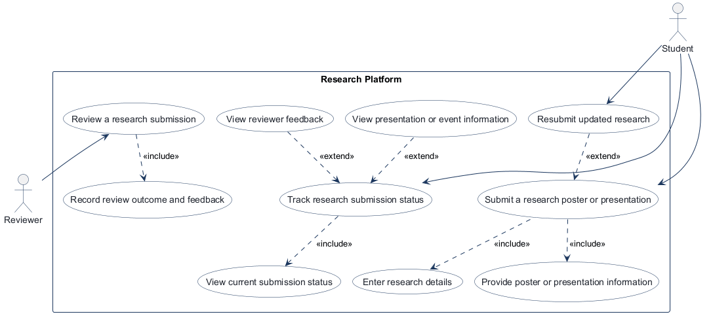
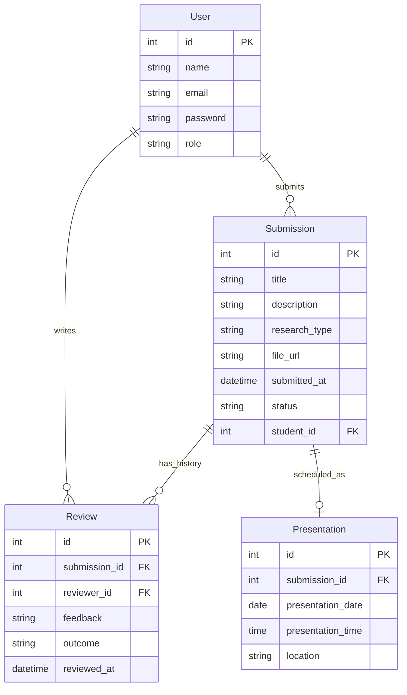
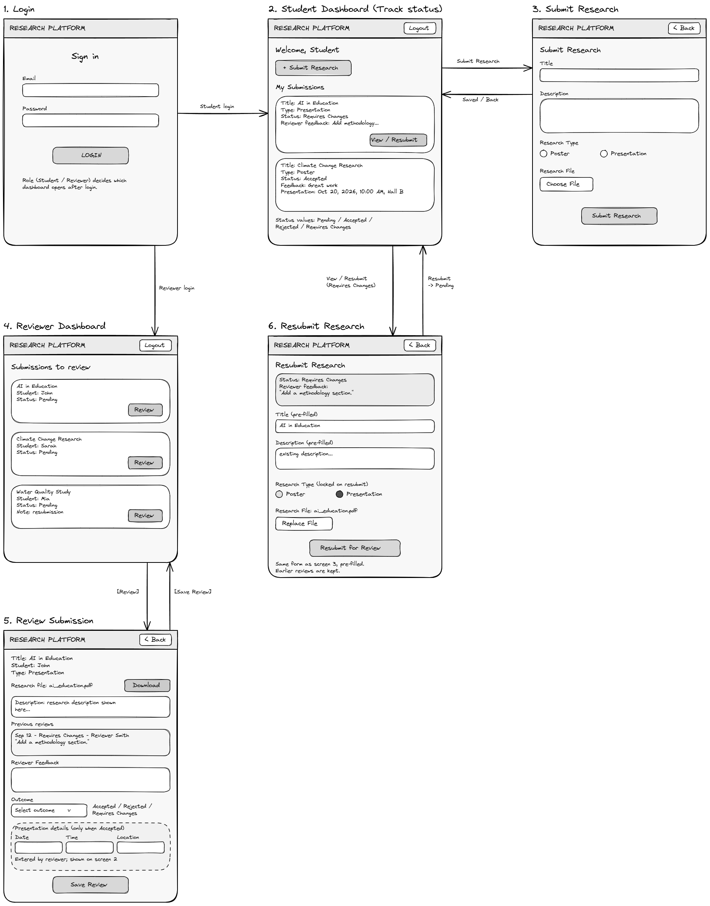

<!-- student-build:skill-integrity
status: pass
root: e84cd692d0b85eefe546385661958c27d07e8be6c5176a82012f68ccff5c8beb
expected_root: e84cd692d0b85eefe546385661958c27d07e8be6c5176a82012f68ccff5c8beb
mismatches: none
-->

# COMP 3613 Assignment 1

Draft this file with the Guide. **Update it after every phase milestone** before you pause. The use-case diagram is a UML PNG at `docs/diagrams/use-case.png`, linked from this file as `diagrams/use-case.png` (path relative to `docs/report.md`). The model diagram is Mermaid. **Embed wireframe images** as `wireframes/<file>` (files live in `docs/wireframes/`).

Do not put your student ID in this file if you will commit it. The PDF cover adds your name and ID at export time.

## Assigned project

Research Platform — a submissions platform for research posters and presentations.

## Three workflows

### 1. Submit a research poster or presentation (Student)

### 2. Review a research submission (Reviewer)

### 3. Track research submission status (Student)

<!-- student-judge:sincerity
round: 1
questions_asked: 2
flags: Detailed workflow steps and completion criteria exceeded the requested Phase 1 workflow names.
sincerity_confidence: 0.78
trend: up
note: Student explained the distinction between submission and later tracking, and described the resubmission path in their own words.
-->

## Use case diagram

Student and Reviewer start separate use cases. Submission includes entering research details and providing poster/presentation information; review includes recording an outcome and feedback; tracking includes viewing the current status. Resubmission extends submission when changes are requested. Viewing feedback and presentation/event information extends tracking when that information is available.

## Model diagram

First draft, based on the student-named entities and properties. Update this section in Phase 5 if polish revises the model, and note what changed.

Relationship and lifecycle notes: one Student can submit many Submissions, each owned by one Student; Review links one Submission to one Reviewer, while each can be associated with many Reviews over time; each Submission may have zero or one Presentation. A newly recorded Review outcome updates Submission.status, while Review records preserve the outcome and feedback history. User.role distinguishes Student from Reviewer. Assume Submission.status reflects the latest Review.outcome. Phase 5 submission decision: the research file upload is optional; students may submit the listed research details without an attached file.

## Wireframes

One combined student-created wireframe covers the supporting login screen and all three named workflows.

### Login, student submission/status, and reviewer review

The screen paths are clear: login routes by role; students can submit, track status and feedback, and resubmit when changes are requested; reviewers can open a submission, record feedback/outcome, and enter presentation details when accepted. Login is supporting access behavior, not an additional named workflow.

The wireframe shows `Submission.title`, `description`, `research_type`, `file_url`, and `status`; reviewer feedback and review history map to `Review.feedback`, `reviewed_at`, `reviewer_id`, and `outcome`; presentation date, time, and location map to `Presentation`. These are already represented in the model, so no model edits are proposed for Phase 4.

<!-- student-build:wireframe-coverage
use_case: Submit a research poster or presentation
image: docs/wireframes/wireframe.png
covered: yes
-->
<!-- student-build:wireframe-coverage
use_case: Enter research details
image: docs/wireframes/wireframe.png
covered: yes
-->
<!-- student-build:wireframe-coverage
use_case: Provide poster or presentation information
image: docs/wireframes/wireframe.png
covered: yes
-->
<!-- student-build:wireframe-coverage
use_case: Resubmit updated research
image: docs/wireframes/wireframe.png
covered: yes
-->
<!-- student-build:wireframe-coverage
use_case: Review a research submission
image: docs/wireframes/wireframe.png
covered: yes
-->
<!-- student-build:wireframe-coverage
use_case: Record review outcome and feedback
image: docs/wireframes/wireframe.png
covered: yes
-->
<!-- student-build:wireframe-coverage
use_case: Track research submission status
image: docs/wireframes/wireframe.png
covered: yes
-->
<!-- student-build:wireframe-coverage
use_case: View current submission status
image: docs/wireframes/wireframe.png
covered: yes
-->
<!-- student-build:wireframe-coverage
use_case: View reviewer feedback
image: docs/wireframes/wireframe.png
covered: yes
-->
<!-- student-build:wireframe-coverage
use_case: View presentation or event information
image: docs/wireframes/wireframe.png
covered: yes
-->

`python manage.py report` also embeds any PNG/JPG still missing from `docs/wireframes/`.

## Theming

Colors: blue and white with light gray backgrounds. Type: clean, simple sans-serif. Tone: professional, simple, and student-friendly. Wordmark: “Research Platform” text, no separate logo.

Applied shared CSS brand tokens and system sans-serif typography to the public landing page, login, registration, and authenticated shell. The landing copy now describes research submissions and review tracking; auth panels and shell use the same blue/white/light-gray palette.

## Implementation notes

Theming is applied to the public landing page, login, registration, and authenticated shell. Student verification: ran the app and confirmed the branding looks as desired.

Workflow 2 decision: reviewer feedback is required for every review outcome.

<!-- student-build:code-check
workflow: Review a research submission
form: choice
layer: other
architecture_ok: yes
implement_confidence: 0.68
passed: yes
note: Student chose to require feedback for every review outcome.
-->

<!-- student-build:code-check
workflow: Review a research submission
form: choice
layer: service
architecture_ok: yes
implement_confidence: 0.64
passed: yes
note: Student chose to require date, time, and location together when adding an optional presentation schedule.
-->

<!-- student-build:code-check
workflow: Review a research submission
form: mcq
layer: service
architecture_ok: yes
implement_confidence: 0.72
passed: yes
note: Student identified the service as coordinating the new review, current submission status, and preserved review history.
-->

<!-- student-build:code-check
workflow: Review a research submission
form: snippet
layer: model
architecture_ok: yes
implement_confidence: 0.76
passed: yes
note: Student added Review outcome, feedback, timestamp, and foreign keys to Submission and User as defined in the ERD.
-->

<!-- student-build:code-check
workflow: Review a research submission
form: snippet
layer: router
architecture_ok: no
implement_confidence: 0.70
passed: no
note: First route attempt was not saved; the STUDENT TODO remained in the file and no handler was available to review.
-->

<!-- student-build:code-check
workflow: Review a research submission
form: snippet
layer: router
architecture_ok: yes
implement_confidence: 0.74
passed: partial
note: Saved route delegates to the service and contains no SQL, but it initially awaited a synchronous method and used a redirect that needs route integration.
-->

<!-- student-build:code-check
workflow: Review a research submission
form: snippet
layer: service
architecture_ok: yes
implement_confidence: 0.60
passed: partial
note: Service attempt fetches Submission, records Review, and updates status, but does not enforce required feedback/outcome values or all-or-none schedule fields; route still needs sync-call integration.
-->

<!-- student-build:code-check
workflow: Review a research submission
form: snippet
layer: service
architecture_ok: yes
implement_confidence: 0.64
passed: partial
note: Revised service validates feedback, outcome, and complete schedules, and updates status through the repository; non-Accepted outcomes still need to reject supplied presentation details.
-->

<!-- student-build:code-check
workflow: Review a research submission
form: snippet
layer: service
architecture_ok: yes
implement_confidence: 0.66
passed: partial
note: Revised student service validates feedback, outcomes, and all-or-none schedules, writes each Review via the repository, and updates Submission.status; Guide completed rejection of schedule data for non-Accepted outcomes.
-->

<!-- student-build:code-check
workflow: Submit a research poster or presentation
form: choice
layer: other
architecture_ok: yes
implement_confidence: 0.82
passed: yes
note: Student chose to allow submissions without an uploaded file.
-->

<!-- student-build:code-check
workflow: Submit a research poster or presentation
form: snippet
layer: model
architecture_ok: yes
implement_confidence: 0.70
passed: partial
note: First model attempt included the fields and optional file; student_id was not declared as the User foreign key until the revision.
-->

<!-- student-build:code-check
workflow: Submit a research poster or presentation
form: snippet
layer: model
architecture_ok: yes
implement_confidence: 0.74
passed: yes
note: Student revised student_id to declare the User foreign key, matching the agreed one-to-many relationship.
-->

<!-- student-build:code-check
workflow: Submit a research poster or presentation
form: snippet
layer: router
architecture_ok: yes
implement_confidence: 0.80
passed: yes
note: Thin route binds form/current user, delegates to SubmissionService via SubmissionRepository, and redirects; no persistence logic in the route.
-->

<!-- student-build:code-check
workflow: Submit a research poster or presentation
form: snippet
layer: service
architecture_ok: yes
implement_confidence: 0.70
passed: partial
note: First service attempt omitted submitted_at and file_url; the revision adds the timestamp, but currently sets file_url to None even when research_file is supplied.
-->

<!-- student-build:code-check
workflow: Submit a research poster or presentation
form: snippet
layer: service
architecture_ok: yes
implement_confidence: 0.52
passed: no
note: Follow-up still leaves file_url=None unconditionally, so an uploaded file is discarded.
-->

<!-- student-build:code-check
workflow: Submit a research poster or presentation
form: snippet
layer: repository
architecture_ok: yes
implement_confidence: 0.60
passed: yes
note: Student repository snippet adds, commits, refreshes, and returns the Submission; SQL remains outside routes.
-->

Workflow 1 — Submit a research poster or presentation: student submissions use the current authenticated user as owner; initial status is Pending; uploaded files are optional and saved outside the public static directory. Resubmission updates the existing Submission and returns it to Pending, preserving its identifier and review association. Resubmission is available only after a review sets the status to `Requires Changes`. Uploaded files currently use local private storage under `data/uploads/`; durable private storage must be configured before deployment. Student verification: ran the app and successfully submitted research with an attached file; the dashboard showed its title, research type, submitted date, and attachment indicator. After reviewer feedback requested changes, the student resubmitted and confirmed the status returned to Pending. Student reported the theme looked as desired. The Guide completed the service's optional file-storage glue after the student's service snippet attempts; those attempts did not yet populate the optional file reference.

Workflow 2 — Review a research submission: feedback is required for every outcome; the latest outcome updates Submission.status while each Review is retained in history. A Presentation is optional, only entered for Accepted, and if scheduled its date, time, and location are all required. Reviewer access currently reuses the FastStarter admin account. The reviewer dashboard lists pending/resubmitted work, the review form shows prior review history, and uploaded files are served through an authenticated owner/reviewer check. Student verification: after the local database was reset to recreate the current schema, the student opened Review for a new submission and confirmed the form loaded. Debugging exposed and fixed a template-context mismatch (`user` required by the authenticated shell) and changed database-recovery behavior to log and surface an error after its single retry instead of redirecting the same failing GET indefinitely. The student saved review outcomes used to verify student tracking and confirmed that the reviewer form shows the earlier review after the submission is resubmitted.

Workflow 3 — Track research submission status: the student chose to show only the latest review feedback together with current presentation details on the dashboard, matching the wireframe. Student code checks added the lifecycle status field to the Submission model and changed the student route to delegate status-card loading to a service. The repository now supplies each student's submissions with the latest review and any current presentation; the dashboard renders status, latest feedback, presentation schedule when present, and resubmit action when changes are required. Student verification: the student checked the Requires Changes feedback/resubmission state and the accepted presentation details and reported that the tracking view looks good. During polish, the student selected distinct colors for all four status badges and confirmed after a hard refresh that the states are easy to distinguish.

Phase 5 local verification and student-directed polish are complete. Local uploads remain under `data/uploads/`; configure durable private storage before deployment.

<!-- student-build:code-check
workflow: Track research submission status
form: choice
layer: other
architecture_ok: yes
implement_confidence: 0.80
passed: yes
note: Student chose latest review feedback and current presentation details for each dashboard card.
-->

<!-- student-build:code-check
workflow: Track research submission status
form: snippet
layer: model
architecture_ok: yes
implement_confidence: 0.80
passed: yes
note: Student completed the Submission status field; service creation already sets the initial state to Pending.
-->

<!-- student-build:code-check
workflow: Track research submission status
form: snippet
layer: router
architecture_ok: yes
implement_confidence: 0.80
passed: yes
note: Thin student route delegates tracking-card loading to SubmissionService using the authenticated student's id; no persistence logic is in the route.
-->

Implement the named workflows one at a time, recording student verification and subsequent polish / model revisions. Do not treat the first build as final.

## Deployed app

Phase 6. Public Render URL (not localhost). Markers open this to mark the three workflows.

https://comp3613a1-ussk.onrender.com/

Deployment check: the public landing page loaded as “Research Platform,” and `https://comp3613a1-ussk.onrender.com/health` returned `{"ok":true}` on 2026-10-09. The student confirmed that both the Student and Reviewer dashboards load after signing in with the marker accounts below. The app uses Render's free web service; uploaded research files are stored on its ephemeral filesystem and may be lost when the service spins down, restarts, or redeploys. The free Render Postgres database expires after 30 days.

## Logins

Every account a marker needs, including extra users you added. Starter accounts:

- bob / bobpass — Student (FastStarter regular-user role)
- admin / adminpass — Reviewer (FastStarter admin role)

## YouTube URL

[Research Platform demo video](https://youtu.be/KunNmDKtJHs)

## Session transcripts

Filled when the Guide builds the report: the agent writes chat markdown into `docs/transcripts/`; `python manage.py report` packages them.

Guide packaged **2** chat(s) in `docs/transcripts/` (and `docs/transcripts.zip`).

Index: [docs/transcripts/INDEX.md](transcripts/INDEX.md)

- [`copilot-cli-guide-session`](transcripts/copilot-cli-guide-session.md)
- [`render-setup-followup`](transcripts/render-setup-followup.md)

## Competency (student-judge)

Filled by Guide from the student-judge run when this report was built.

**Judged at:** 2026-10-11T16:36:36-04:00
**Evidence pass:** re-read both available native Copilot CLI project sessions, current `docs/report.md`, both Guide-written transcript files, `docs/diagrams/`, and `docs/wireframes/`; prior scorecard ignored.

**Student / session:** Research Platform student / Copilot CLI project session
**Artifact:** Available Copilot CLI Guide sessions, current project artefacts, and Guide-written transcript digests
**Phases in evidence:** COMP 3613 Phases 1–6 (Phase 5 includes polish; Phase 6 deployment now verified)

### Totals

| | Count / value |
|--|--|
| Metrics on rubric | 12 (M1–M12) |
| N/A (excluded) | 0 |
| Metrics scored | 12 |
| Scoreable max | 12 × 4 = 48 |
| Awarded total | 44 / 48 |
| **Overall (avg of scored)** | **3.7 / 4** |
| Impression mark | 16 / 20 (Guide confidence 0.78) |

## Scorecard

| ID | Metric | Score / 4 | In avg | Evidence |
|----|--------|----------:|:------:|----------|
| M1 | Phase discipline | 4 | yes | The student completed Phase 5 verification and polish before proceeding to Phase 6; deployment was recorded after `/health` and dashboard checks. |
| M2 | Problem framing | 3 | yes | Student-owned workflows, model, relationships, and theme are recorded in `docs/report.md`; the student clarified workflow distinctions in their own words during the Phase 1 check. |
| M3 | Decision ownership | 3 | yes | Student selected optional uploads, required review feedback, all-or-none presentation details, latest feedback display, badge colors, and the free Render service despite temporary uploads. |
| M4 | Artefact-before-code | 4 | yes | The report includes the UML use-case diagram, student-named ERD, and student-created wireframe; implementation and deployment continue to reference those artefacts. |
| M5 | Verification habit | 4 | yes | Student reported local workflow results and polish checks, then confirmed: “Both dashboards load.” The Guide also verified the public health response as `{"ok":true}`. |
| M6 | Assignment fit | 4 | yes | The app follows the layered architecture recorded in the report, reuses FastStarter authentication and seeded roles, and deployed to Render only after local workflow polish. The temporary free-tier upload behavior is disclosed. |
| M7 | Slice explanation | 3 | yes | Student completed model and thin-route snippets across workflows and made layer-respecting decisions; several snippet attempts required revision or Guide-completed glue. |
| M8 | Prompt quality | 3 | yes | The student used phase-specific prompts, supplied the public deployment URL, stated a clear Render/free-tier preference, and provided the video URL for the report. |
| M9 | Response to pushback | 4 | yes | The student persisted through review-flow errors with traceback checks, continued local verification and badge polish, and accepted a deliberate free-tier file-persistence tradeoff after it was explained. |
| M10 | Integrity | 4 | yes | No external-solution paste or edited-skill evidence found. The Phase 1 confidence check cleared after the student explained workflow distinctions in their own words. |
| M11 | Provenance continuity | 4 | yes | The project remained the Research Platform with the same three named workflows, ERD, wireframe, brand preferences, and Render service throughout the available session. |
| M12 | Sincerity trajectory | 4 | yes | One logged sincerity round reached 0.78 with an upward trend and was cleared; no later laundering flags appeared. |

## Strengths

- Student-owned workflows, model, wireframe, theme, and implementation choices guided the work.
- Student attempted model and thin-route snippets and participated in correcting implementation details.
- Local verification included workflow outcomes, review-history behavior, resubmission, and student-directed badge polish.
- Phase 6 deployment is live at the reported URL; `/health` succeeded and the student confirmed both role dashboards load.
- Known free-tier limitations are recorded rather than presented as durable file storage.

## Gaps (priority order)

1. No remaining assignment gate is identified. The chosen free Render tier has acknowledged operational limits: uploaded files on the web service filesystem are ephemeral, and the free Postgres database expires after 30 days. Upgrade or backup planning would be needed for continued long-term use, but it is not an unreported deployment failure.

## Phase gate status

| Phase | Status | Note |
|-------|--------|------|
| 1 | met | Research Platform and three student-named workflows are recorded. |
| 2 | met | UML use-case diagram is generated and embedded, with include/extend notes. |
| 3 | met | Student-named entities, fields, relationships, and lifecycle notes are recorded in the ERD. |
| 4 | met | Student-created wireframe is present and embedded; workflow coverage is recorded. |
| 5 | met | Theme, sequential workflow implementation, student verification, and student-selected polish are recorded. |
| 6 | met | Public Render URL is recorded; `/health` succeeded and the student confirmed both Student and Reviewer dashboards load. |

## Recommended next practice

- For a future long-lived deployment, choose storage that survives web-service restarts and plan for the free Postgres expiration before relying on the demo data.

## Integrity note

**Cleared after suspicion spiral.** The report records one initial Phase 1 confidence check; the student explained workflow distinctions in their own words and confidence rose to 0.78. No unresolved external-assist evidence was found.

## Provenance flags

- One Phase 1 confidence check is recorded and cleared after clarification. The available session tool returns compact assistant digests for older turns; student prompts and carried-forward Phase 5 evidence are documented in the transcript files. A second native session contains only brief Render setup follow-up; both available sessions are represented.

## Sincerity log summary

- Blocks found: 1 | max round: 1 | min/mean/final confidence: 0.78 / 0.78 / 0.78 | trend: up | cleared: yes

## Skips

- Skips: 0/3 used. No skip was recorded in the available chat or report.

## Skill integrity

Course skills are hashed at export and compared to `.agents/skills.lock.json`. Do not edit `.agents/skills/`, `.cursor/skills/`, or `AGENTS.md`.

- Status: **pass**
- Root: `e84cd692d0b85eefe546385661958c27d07e8be6c5176a82012f68ccff5c8beb`
- none
## Skill integrity

Course skills are hashed at export and compared to `.agents/skills.lock.json`. Do not edit `.agents/skills/`, `.cursor/skills/`, or `AGENTS.md`.

- Status: **pass**
- Root: `e84cd692d0b85eefe546385661958c27d07e8be6c5176a82012f68ccff5c8beb`
- none
## Skill integrity

Course skills are hashed at export and compared to `.agents/skills.lock.json`. Do not edit `.agents/skills/`, `.cursor/skills/`, or `AGENTS.md`.

- Status: **pass**
- Root: `e84cd692d0b85eefe546385661958c27d07e8be6c5176a82012f68ccff5c8beb`
- none
